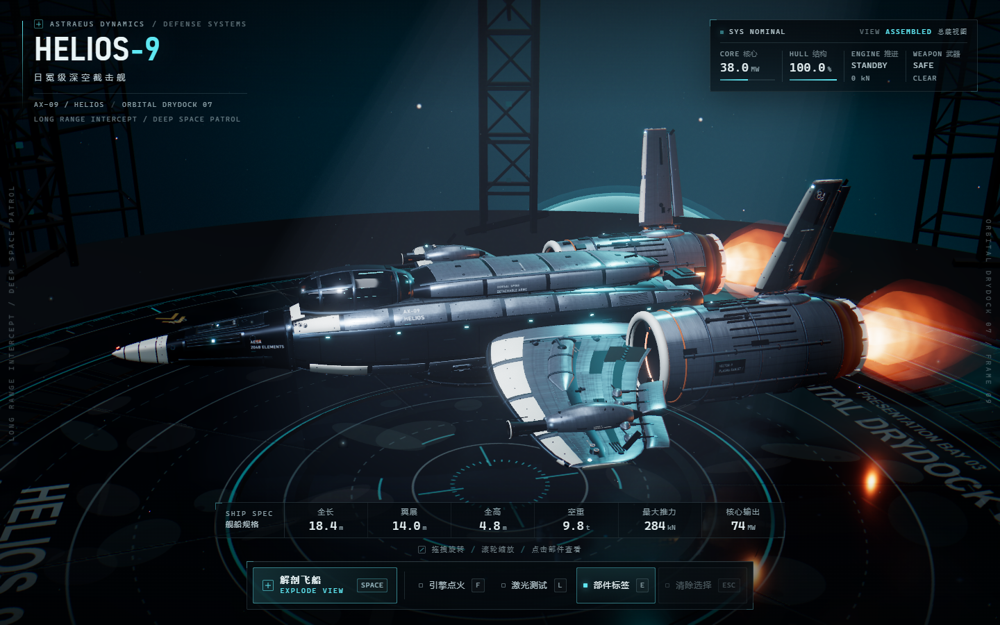

# HELIOS-9 · 日冕级深空截击舰

一个可交互的 3D 宇宙飞船展示站：电影级轨道干坞、完整硬表面舰体、一键爆炸剖析、11 个可查看部件、等离子尾焰和双路激光测试。全部几何、材质与贴图均为程序化生成，无外部模型或贴图依赖。



## 快速启动

```bash
npm install
npm run dev
```

打开 `http://127.0.0.1:4173`。

生产构建：

```bash
npm run build
npm run preview
```

需要支持 WebGL2 的现代浏览器。推荐桌面 Chrome / Edge，显卡为独立显卡或较新的集成显卡。

## 交互

| 操作 | 说明 |
| --- | --- |
| 鼠标拖拽 / 单指拖拽 | 环绕观察飞船 |
| 滚轮 / 双指捏合 | 缩放 |
| 空格 / 解剖飞船 | 一键爆炸剖析，再按一次复位总装 |
| F / 引擎点火 | 切换待机与加力燃烧，尾焰长度、亮度与喷口光同步增强 |
| L / 激光测试 | 双翼 LANCE-7 粒子炮试射；相机自动切到高机位展示双束，爆炸视图下禁用 |
| E / 部件标签 | 显示或隐藏 3D 部件标注 |
| Esc / 清除选择 | 取消当前部件选中与详情 |
| 点击舰体 / 部件索引 | 查看该部件的功能说明、分类与三项规格 |

部件索引共 11 项：前向传感阵列、主承力船体、座舱系统、背脊装甲、聚变核心、左右主翼、左右推进器、矢量尾翼、腹部任务舱。爆炸状态下每个模块沿独立矢量分离并错峰展开，3D 标签和右侧详情同步。

## 视觉与实现

- **场景**：半径 19.2 m 的轨道干坞甲板、程序化标线/格栅/危险箭头、湿地反射、三层星空、星云穹顶、行星临边与大气辉光、远处桁架剪影、体积光与尘埃。
- **灯光**：冷色主光 + 青色轮廓光 + 正面补光 + 暖色引擎反光，drei `Environment` / `Lightformer` 提供 PBR 反射；爆炸视图额外补光，恢复分离模块的暗面细节。
- **后期**：Bloom、轻微色差、Vignette、显式单次 ACES ToneMapping、胶片噪点。
- **飞船**：约 13 万三角面、程序化面板/铆钉/划痕粗糙度贴图、装甲层叠、外露结构梁、液压作动器、RCS、贴花、座舱内部、聚变核心、陶瓷喷口、热变色内衬。
- **特效**：基于 GLSL 的多层等离子羽流（噪声、旋流、激波钻石、白热芯到橙色外焰、加力拉伸）和双层激光（细白芯、青色内辉光、低强度外晕、脉冲节点），全部使用加色混合与深度写入关闭，避免 z-fighting。
- **HUD**：深空军工技术风，Bahnschrift / Cascadia Mono，近直角 2px 圆角，单一离子青强调色；桌面三栏、1024 紧凑桌面、390x844 移动端三套布局；键盘、ARIA、`prefers-reduced-motion` 均已处理。

## 目录

```text
src/
  App.tsx                 场景入口与渲染器配置
  data/ship.ts            11 个部件、规格、爆炸矢量、炮口坐标
  state/ship.tsx          爆炸/选择/点火/激光/加载状态
  scene/
    Environment.tsx       干坞、星空、行星、灯光、体积光、尘埃
    Post.tsx              后期处理
    CameraRig.tsx         英雄机位、爆炸机位、激光高机位
    Ship.tsx              总装与爆炸补光
    ship/ShipPart.tsx     爆炸动画、拾取、标签
    ship/materials.ts     程序化 PBR 材质与贴花
    ship/parts/           舰体、座舱、内部、机翼、尾翼、发动机
    effects/              PlasmaPlume / LaserFX
  ui/Hud.tsx, hud.css     全部 HUD 与响应式样式
docs/                     预览图与拼版
```

## 验证

- `npm run build`：TypeScript + Vite 生产构建通过。
- 无头 Chromium（RTX 4050，1440x900）实测约 116 fps，无 console error / page exception。
- 1440x900、1024x768、390x844 三档截图通过；移动端按钮触控高度均不小于 40 px。
- 一键剖析、标签开关（11 → 0 → 11）、部件选中详情、Esc 清除、爆炸时激光锁定、复位总装均已自动化验证。

## 预览

- [总装视图](docs/hero.png)
- [爆炸剖析](docs/exploded.png)
- [引擎点火](docs/ignition.png)
- [激光测试](docs/laser.png)
- [移动端](docs/mobile.png)
- [四图拼版](docs/contact-sheet.png)
